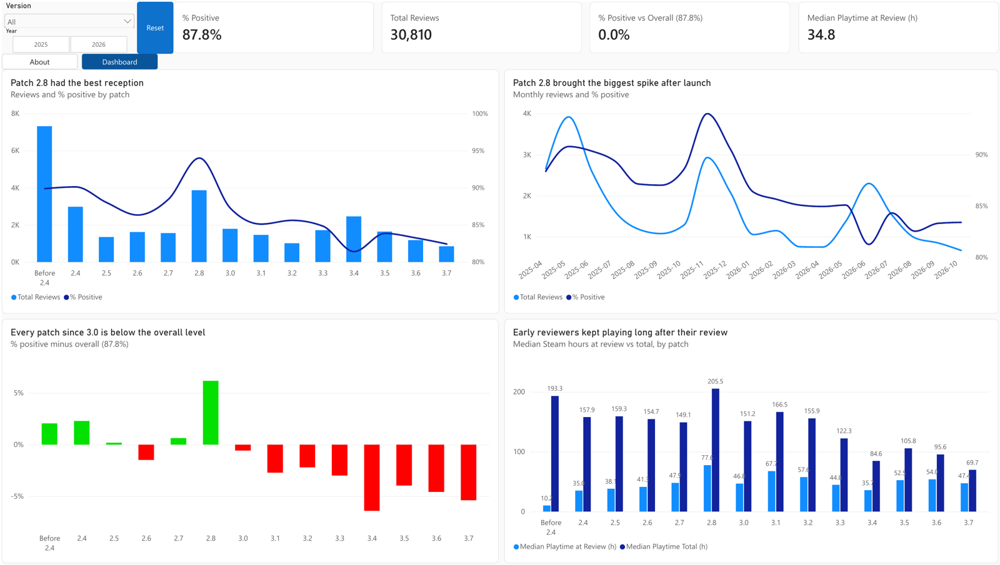
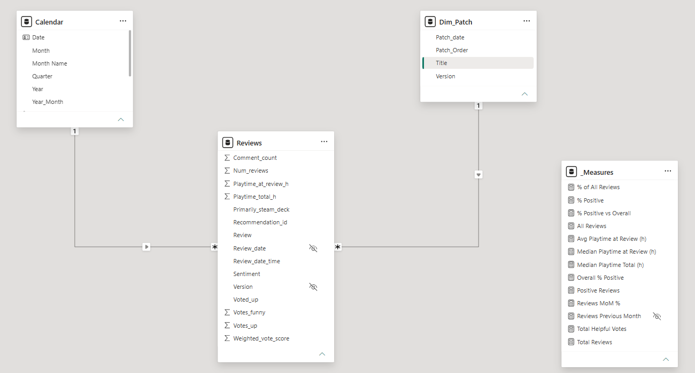
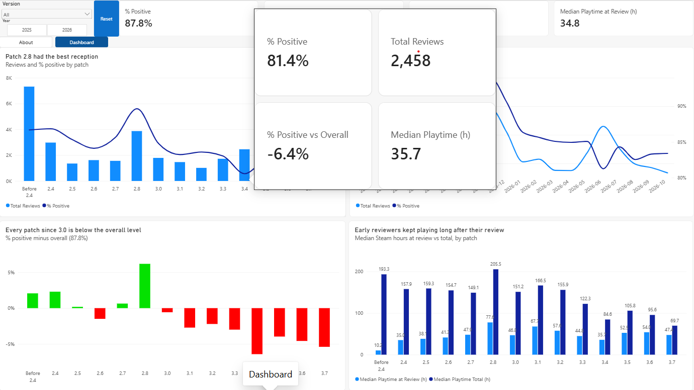

# WuWa Steam Reviews - Sentiment Analysis & Power BI Dashboard

An end-to-end data project analyzing Steam reviews for the gacha ARPG
*Wuthering Waves* (WuWa), collected directly from Steam's public API. The goal
is to understand how player sentiment changes after each game update (patch),
and which patches were received well or badly.

The project has two parts:

1. **Python / pandas** - data collection, cleaning and exploratory analysis (`notebooks/`, `src/`)
2. **Power BI** - a data model, DAX measures and an interactive dashboard (`powerbi/`), added in November 2026



## Motivation

As a daily player of WuWa, I wanted to apply data analysis to a domain I
understand well enough to interpret correctly, using entirely self-collected
data rather than a pre-packaged dataset.

## Data Sources

Both pulled live from official, public, key-free Steam endpoints:

- **Reviews:** `api.steampowered.com/IUserReviewsService/GetAppReviews/v1/`. Valve retired the old `store.steampowered.com/appreviews` endpoint on 22 October 2026, so the collector was rewritten for the new API (`src/collect_reviews_v3.py`, `src/collect_reviews_range.py`).
- **Patch history:** `api.steampowered.com/ISteamNews/GetNewsForApp` (Steam News API)
- AppID used: `3513350` (Wuthering Waves)

Current dataset (used in the Power BI part): **30,810 English-language reviews**
(28/04/2025 to 04/11/2026) and **21 news items**, filtered to **13 patch
releases** (2.4 to 3.7).

The first pandas analysis used an earlier pull of 28,218 reviews (to 23/07/2026).

## Power BI Dashboard (November 2026)

**Files:** [`powerbi/WuWa_Reviews.pbix`](powerbi/WuWa_Reviews.pbix) · [`powerbi/WuWa_Report.pdf`](powerbi/WuWa_Report.pdf) (full report)

### Questions

1. How many players review the game after each patch, and how many of them recommend it?
2. Which patches performed above or below the overall level?
3. How do review volume and sentiment change month by month?

### Data model

A star schema with one fact table and two dimensions.

- **Reviews** (fact): one row per review, 30,810 rows
- **Dim_Patch**: one row per patch, plus a "Before 2.4" row for reviews written before the first patch in the news data
- **Calendar**: full years 2025 and 2026, marked as date table

Each review is assigned to the latest patch released on or before its review date. Merge cannot do a "less than or equal" match, so this is a custom Power Query step (`Table.SelectRows` + `Table.Max`).



### Key findings

- **87.8%** of all reviews recommend the game.
- **Patch 2.8 had the best reception** (94.0% positive, +6.2 points above the overall level).
- **Every patch from 3.0 onward is below the overall level.** Patch 3.4 is the lowest at 81.4%.
- The busiest month is May 2025 (Steam launch). After the launch, the biggest spike is **November 2025** (2,930 reviews, the highest % positive of any month), which matches patch 2.8.
- Early reviewers had a median of only 10.2 Steam hours when they wrote their review, but 193.3 hours by the download date. Most of them stayed.

### Interactive features

Version and Year slicers, edited visual interactions, cross-filtering between charts, a custom tooltip page, a Reset button (Clear all slicers) and a page navigator.



### Correction to the pandas notebook

The first notebook treated `playtime_at_review` as hours. Steam returns it in **minutes**. The Power BI version converts minutes to hours. The pandas findings that compare playtime between groups are not affected, because they use relative values, but absolute hour values in the notebook should be divided by 60.

## Project Structure

```
wuwa-review-analysis/
├── data/                         # raw collected JSON (gitignored, not pushed)
├── notebooks/
│   └── 01_data_cleaning_eda.ipynb
├── powerbi/
│   ├── WuWa_Reviews.pbix         # Power BI report (data model + dashboard)
│   ├── WuWa_Report.pdf           # project report
│   └── screenshots/
├── src/
│   ├── collect_reviews_v3.py     # review collection, new GetAppReviews API
│   ├── collect_reviews_range.py  # review collection for a date range
│   ├── collect_reviews.py        # original collector (old endpoint, retired)
│   ├── collect_patches.py        # patch/news history collection
│   └── test_setup.py             # environment sanity check
├── requirements.txt
└── README.md
```

## Pandas Analysis (first part)

### Methodology

1. **Collection** - paginate through the Steam Reviews API (100 reviews/page,
   cursor-based) until exhausted; checkpoint every 20 pages to avoid data loss
   on interruption.
2. **Cleaning** - flatten nested JSON with `pd.json_normalize`, drop
   fields with 93%+ missingness (Steam Deck-only hardware info), drop
   reviewer-identifying fields (not needed for analysis, and avoided in
   the interest of not baking real usernames into a public notebook),
   normalize an inconsistently-typed field (`weighted_vote_score` comes
   back as either a string or a float depending on vote count), and
   validate with sanity checks (zero duplicate reviews, date range matches
   the game's actual Steam launch date).
3. **EDA** - weekly % positive over time, overlaid with patch release dates
   and review volume (to separate real signal from small-sample noise);
   deep dive into the lowest point in the sentiment timeline, testing and
   revising two hypotheses along the way using the review text and
   reviewer playtime rather than assumption.

### Key findings (28,218 reviews, to July 2026)

- Sentiment shows a **gradual decline**, not a single review-bomb event -
  from ~90% positive at launch to a noisier 80-85% band by mid-2026, with
  short-lived spikes around major content updates.
- The lowest point in the timeline (week of 2026-06-08) was initially
  suspected to be noise from a small sample, but at 865 reviews that week
  it turned out to be a real signal.
- That dip has a **mixed cause**: median playtime among reviewers that week
  was less than half the dataset-wide median, and ~17.5% of negative
  reviews mentioned onboarding friction (large download size, forced
  external account creation, a Discord Quest campaign driving new,
  low-intent installs) - but this is a contributing factor, not the
  dominant one. The remaining ~82.5% raised recurring, non-specific
  complaints (monetization, gacha fatigue) present across most weeks.

## Setup & Reproduction

```bash
python -m venv venv
.\venv\Scripts\Activate.ps1        # Windows
pip install -r requirements.txt

python src/collect_patches.py
python src/collect_reviews_v3.py   # paginates ~30k reviews

# then open notebooks/01_data_cleaning_eda.ipynb and run all cells
```

To refresh the Power BI report with new data, open `powerbi/WuWa_Reviews.pbix`
and update the two file paths in Power Query (Transform data > Data source
settings) to your `data/` folder.

## Limitations

- English-language reviews only (~62% of total reviews on this title),
  so non-English player sentiment isn't represented.
- Steam is only one of WuWa's platforms. Playtime only counts Steam hours,
  and many players used the game's own launcher before the Steam release.
- April 2025 and November 2026 are incomplete months in the current dataset.
- The data shows when sentiment changed, not why.

## Status

- [x] Data collection (updated for the new Steam API)
- [x] Cleaning & EDA (pandas)
- [x] Power BI data model, DAX measures and dashboard
- [x] Project report
- [ ] Feature engineering
- [ ] Classification model (Recommended vs. Not) with class-imbalance handling

## Tech Stack

Python, pandas, numpy, scikit-learn, matplotlib, seaborn, VADER (sentiment),
imbalanced-learn, Jupyter, Power BI (Power Query, DAX).

## Acknowledgments

I used Claude to help design the data pipeline, debug issues as they came up,
and review the analysis and Power BI work throughout this project. I ran every
step myself, tested the results, and interpreted the findings using my own
understanding of Wuthering Waves as a player.
